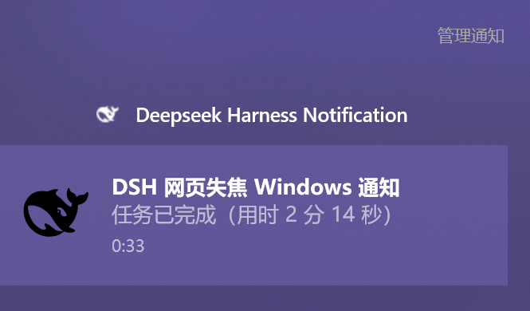

# dsh-desktop-notify

> 所有 DSH 前端都失焦时，把「需要你决策 / 需要你授权 / 意外中断 / 任务完成」发到 Windows 通知中心；通知标题是会话标题，点击通知复用已打开的 DSH 页面切回对应对话。



## 安装

```powershell
dsh plugin --profile web add github:CarbonZhao-02692/dsh-desktop-notify
```

重启 `dsh web`，然后硬刷新页面（Ctrl+Shift+R）。插件目前未发布 NPM 包，所以用 `github:` 源码安装；发布 NPM 后可直接用包名一键安装。

## 能力分类

界面与体验。

## 它能做什么

| 事件 | 触发点 | 通知内容 |
|---|---|---|
| 需要你选择决策 | `user-questions/request`（含方案确认 plan-review） | `需要你选择决策：<问题>` |
| 需要你授权 | `approval/request` | `需要你授权：<工具名> — <原因>` |
| 意外中断，请重试 | `turn/end` reason=`error` / `interrupted` / `max-tokens`，以及 `api-session/error` | `任务意外中断：<错误>，请重试` |
| 任务已完成 | `turn/end` reason=`completed` | `任务已完成（用时 X）` |

通知标题取自**对应会话的标题**（`sessionTitle` 服务折叠出的标题）；标题还没生成时回退到该会话第一条用户消息。通知正文是对应提示。

## 焦点判定：所有 DSH 前端都失焦

每个 DSH 页面每 3 秒向 `/dsh-desktop-notify/focus` 上报：

```json
{ "id": "页面 id", "focused": true, "visible": true }
```

`focused = document.visibilityState === 'visible' && document.hasFocus()`。浏览器窗口失焦、切到其他标签页、焦点在地址栏，都会使 `focused` 为 false。

host 的门控只有一条：

- **任意一个页面 `focused=true` → 不是“所有前端失焦”，静默不发。**
- **所有已上报页面 `focused=false` → 发通知。**
- 页面关闭时通过 `sendBeacon` 上报 `closed: true`，立即从汇总移除。
- 后台标签页的定时器可能被浏览器节流，所以 3 分钟内没有心跳才按已关闭处理；所有页面都关闭时视为“全部失焦”。

`visible` 只用于状态展示，不参与门控。

## 点击通知回到对话

点击 toast 优先复用已经打开的 DSH 页面，不新开标签页：

1. toast 的 `launch` 是 `dsh-desktop-notify://open?session=<id>&origin=<origin>`，`activationType="protocol"`。
2. Windows 调用已注册的协议 helper：`assets/open.ps1`（注册在 `HKCU\Software\Classes\dsh-desktop-notify`）。
3. helper 把会话 id POST 到 host 的 `/dsh-desktop-notify/activate`，然后用 `ShowWindow` / `SetForegroundWindow` 恢复并置前 Edge/Chrome 窗口（最小化也可以恢复）。
4. helper 通过 UI Automation 把标题匹配的 DSH 标签页切到前台（浏览器停在别的标签页时也能回来）；标题已变化时用目标会话标题兜底。
5. 已打开的 DSH 页面每秒轮询 `/dsh-desktop-notify/activation`；收到请求后调用 `uiWorkspace.openSession(sessionId)`，页面切到对应对话，并尝试 `window.focus()`。
6. host 只把请求投递给**用户最后使用的那个页面**，多标签不会一起跳。

**没有页面时的兜底**：如果 host 发现没有任何已连接的 DSH 页面，会让 helper 在默认浏览器打开一个引导页；引导页把会话 id 写入 `localStorage` 并跳回 DSH，新页面加载后自动打开对应对话。

## 设置页与测试

DSH 设置 → 通用 → **桌面通知**：

- 显示当前上报页面数和焦点汇总状态（有前端聚焦 = 静默中 / 全部失焦 = 会通知）。
- “发送测试通知”按钮：强制发一条 Windows toast，忽略焦点门控，用来验证通知权限、应用名、图标与点击行为。

也可以直接调用 HTTP 接口：

```powershell
# 查看焦点状态与最近通知
Invoke-WebRequest -UseBasicParsing http://127.0.0.1:3080/dsh-desktop-notify/status

# 强制发一条测试通知（force 忽略焦点门控；带 sessionId 时点击会回到该对话）
$body = @{ kind='complete'; force=$true; sessionId='session-...'; body='测试通知' } | ConvertTo-Json -Compress
Invoke-WebRequest -UseBasicParsing -Method POST -ContentType 'application/json' `
  -Body ([Text.Encoding]::UTF8.GetBytes($body)) `
  http://127.0.0.1:3080/dsh-desktop-notify/test
```

## 配置

默认值在 `lib/index.js` 的 `DEFAULTS` 里；通过 loader 行的 `config` 覆盖：

```yaml
- id: dsh-desktop-notify
  name: '@dsh-external/dsh-desktop-notify'
  config:
    onlyWhenUnfocused: true   # false = 页面聚焦时也发
    clickToOpen: true         # false = 通知不可点击回会话
    ignoreSubagent: true      # 后台子代理会话不提醒
    notifyOnDecision: true
    notifyOnApproval: true
    notifyOnInterruption: true
    notifyOnComplete: true
    minTurnDurationMs: 0      # 完成提醒的最短轮次时长（毫秒）
    toastAppId: 'DeepSeek.DSH.Notify'
    toastAppName: 'Deepseek Harness Notification'
    toastIconPath: ''         # 默认 assets/deepseek-harness.png
    toastAppIconPath: ''      # 默认 assets/deepseek-harness.ico
```

## 兼容与运行要求

- DSH `web` profile；实测 `0.2.1-rc.2`（当前 checkout）。
- Windows 10 / 11，Windows PowerShell 5.1（WinRT toast）。
- Node.js >= 20。
- 页面必须保持打开才能上报焦点；没有页面时点击通知会走兜底新开页。
- 浏览器 / DSH Desktop 需要允许 Windows 通知；系统“专注助手”可能拦截。
- 仅实现 Windows toast；其他平台只写日志、不发通知。

## 权限与外部服务

- 写入 `HKCU\Software\Classes\dsh-desktop-notify`（自定义协议 helper）。
- 写入 `HKCU\Software\Classes\AppUserModelId\DeepSeek.DSH.Notify`（应用名与图标）。
- 通过 `powershell.exe` 显示 toast，并在临时目录写一个 `.ps1` 脚本。
- helper 使用 Windows UI Automation 查找并切换浏览器标签页（不需要管理员权限）。
- 本机 HTTP 路由：`/focus`、`/status`、`/test`、`/activate`、`/activation`、`/open`；其中 `/activate` 和 `/open` 只接受 loopback 请求，`/open` 还需要每次进程随机生成的密钥。
- 没有外部服务、没有上传、没有网络请求（除本机 DSH 地址）。

## 真实输出

Toast XML（点击会激活自定义协议）：

```xml
<toast activationType="protocol" launch="dsh-desktop-notify://open?session=session-...&amp;origin=http%3A%2F%2F127.0.0.1%3A3080">
  <visual><binding template="ToastGeneric">
    <text>MC游戏存档崩溃修复</text>
    <text>点击通知应回到对应对话</text>
    <image placement="appLogoOverride" src="file:///.../assets/deepseek-harness.png"/>
  </binding></visual>
  <audio src="ms-winsoundevent:Notification.Default"/>
</toast>
```

日志片段：

```text
activation queued session=session-... target=dsh-... live=2
activation delivered session=session-... client=dsh-...
bootstrap page served session=session-...
```

## 已知限制

- 后台子代理会话默认不提醒（它们的完成由主对话那一轮覆盖）。
- 窗口恢复/置前对 Edge/Chrome 使用 Win32 `ShowWindow` + `SetForegroundWindow`；系统前台锁定、虚拟桌面切换等极端情况仍可能失败。
- 标签页切换 / 窗口激活目前针对 Edge / Chrome；DSH 在 Firefox 中时不会自动切回该标签页。
- 标签页切换按标题匹配；多个标签页标题相同时，可能选中同标题的另一个 DSH 标签页（仍会落在对应会话）。
- helper 日志：`%TEMP%\dsh-desktop-notify-helper.log`。
- 自定义协议 helper 需要插件加载时注册；如果移动了插件目录，重新加载插件会更新注册。
- Windows 可能缓存 AUMID 的应用名/图标；重启 Explorer 或清空通知历史后会刷新。

## 开发

插件是纯 ESM/CJS JavaScript，无构建步骤、无第三方运行时依赖。

- host：[lib/index.js](lib/index.js)
- client：[lib/client.js](lib/client.js)
- 协议 helper：[assets/open.ps1](assets/open.ps1)
- 图标：[assets/deepseek-harness.png](assets/deepseek-harness.png)、[assets/deepseek-harness.ico](assets/deepseek-harness.ico)
- 条目：[cordis.patch.yml](cordis.patch.yml)

本地修改后重新加载插件或重启 DSH。

## License

MIT。见 [LICENSE](LICENSE)。

图标来自官方 DSH 前端资源（MIT）；DeepSeek Harness 与鲸鱼标识归各自所有者，本插件非官方出品。见 [NOTICE](NOTICE)。
